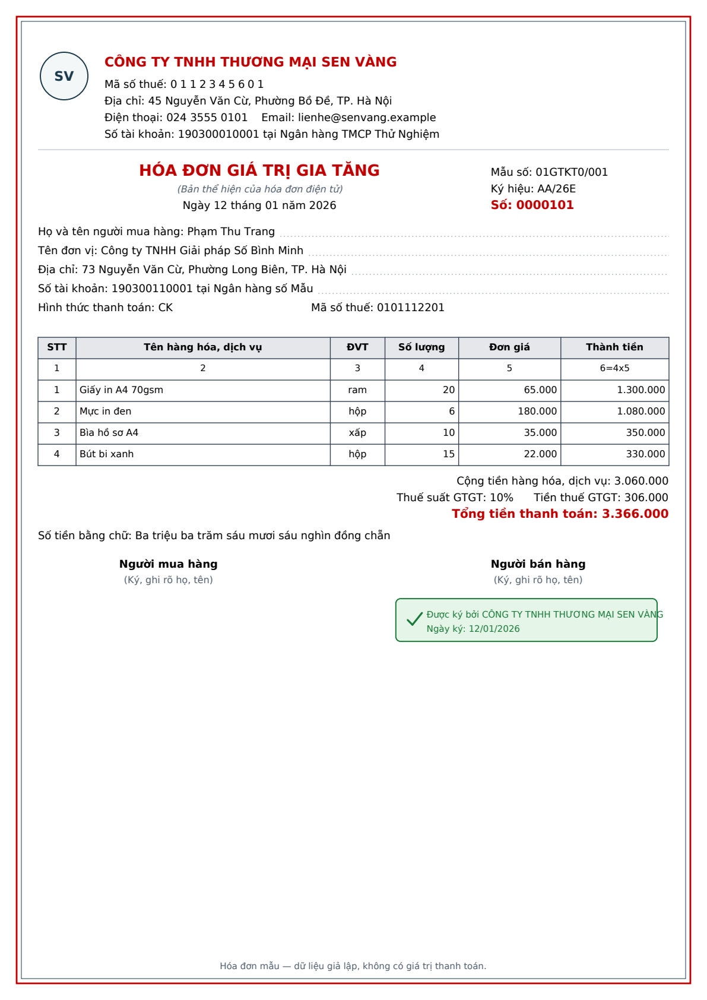

# Invoice PDF Extractor

Supplier invoices arrive as PDFs. Retyping the invoice number, tax code, line items, and VAT into a spreadsheet is slow, and a wrong total or a missing tax code is easy to miss.

This project reads a folder of Vietnamese VAT invoices, checks the numbers (including the amount in words), and writes one Excel workbook. Every company, person, tax code, phone, email, and bank account in the samples is fictional. Street names are real; house numbers are not. Addresses use the Hanoi wards and communes in force after the 1 July 2025 reform, with no district level: `45 Nguyễn Văn Cừ, Phường Bồ Đề, TP. Hà Nội`.

## Features

- Builds 10 sample VAT invoices (hóa đơn GTGT) on A4: seller block with a text monogram, red title, buyer block, items table, totals, amount in words, and a signature box.
- Vietnamese text is drawn with DejaVu Sans.
- Extracts mẫu số, ký hiệu, số hóa đơn, the date (`Ngày dd tháng mm năm yyyy`), seller and buyer (name, tax code, address), payment method, line items, subtotal, VAT, total, and the amount in words.
- Checks each invoice, and reports every problem in Vietnamese and English:
  - required fields are present
  - tax codes are 10 digits, or 13 digits for a branch (`0123456789-001`)
  - line amounts add up to the subtotal
  - subtotal × VAT rate equals the VAT amount
  - subtotal + VAT equals the total
  - the amount in words matches the total
- Writes `invoices.xlsx`. Money uses the format `#,##0`. Status is `OK` or `LỖI / ERROR`. Error rows are filled red, and Ghi chú / Note holds the Vietnamese summary. The Issues sheet has `Lỗi (VI)` and `Issue (EN)` columns.

## Before and after

**Before:** `sample_input/` holds 10 PDF invoices. Two are wrong on purpose.

**After:** one workbook.

| Sheet | Contents |
| --- | --- |
| Invoices | One row per PDF, with status and a Vietnamese note |
| Line Items | One row per product |
| Issues | One row per problem, in Vietnamese and English |

On the included sample run, 8 invoices are `OK` and 2 are `LỖI / ERROR`:

- `07_thiet_bi_so_lam.pdf` prints a total of 15,520,000. Subtotal + VAT is 14,520,000.
- `09_co_khi_bac_nam.pdf` leaves the seller tax code off the page.

A copy of that run is in `sample_output/invoices.xlsx`. Running the tool again writes `output/invoices.xlsx` (that folder is gitignored).

## How to run

From this folder, with the virtual environment activated:

```powershell
.\.venv\Scripts\Activate.ps1
python make_samples.py
python main.py sample_input
```

`make_samples.py` needs `fonts/DejaVuSans.ttf` and `fonts/DejaVuSans-Bold.ttf`. Built-in PDF fonts cannot draw Vietnamese letters such as ă, ê, ơ, ư, and đ.

To choose a different output path:

```powershell
python main.py sample_input -o output/invoices.xlsx
```

If you do not have the virtual environment yet:

```powershell
python -m venv .venv
.\.venv\Scripts\Activate.ps1
pip install -r requirements.txt
python make_samples.py
python main.py sample_input
```

If PowerShell blocks activation, call the interpreter directly: `.venv\Scripts\python.exe main.py sample_input`.

## Input: sample invoice

A valid fictional invoice. The red total, the amount in words, and the green signature box are part of the same page.



Hóa đơn GTGT mẫu: khối người bán, tiêu đề đỏ, người mua, bảng hàng hóa và tổng tiền bằng số lẫn bằng chữ.

## Output: validated Excel

The Invoices sheet flags the two bad files in red. The Issues sheet gives the reason in both languages.


Sheet Invoices tô đỏ 2 hoá đơn lỗi, sheet Issues ghi rõ lỗi bằng cả tiếng Việt và tiếng Anh.

## Project layout

```
make_samples.py    build the sample PDFs
vnd_words.py       read a total in Vietnamese words
extractor.py       read one PDF
validator.py       list what is wrong, in Vietnamese and English
main.py            folder of PDFs in, workbook out
sample_input/      generated invoices
sample_output/     one finished run, plus the pictures above
fonts/             DejaVu Sans (Vietnamese Unicode)
```
