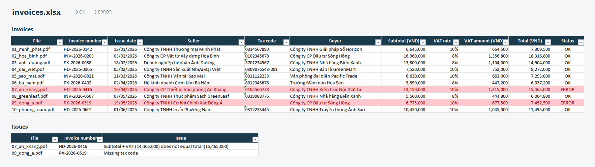

# Invoice PDF Extractor

Supplier invoices often arrive as PDFs. Someone then retypes the invoice number, tax code, line items, and VAT into a spreadsheet. That is slow, and a wrong total or a missing tax code is easy to miss.

This project reads a folder of Vietnamese supplier invoices, checks the numbers, and writes one Excel workbook. The sample companies and amounts are fictional.

## Features

- Generates 10 sample invoices in three layouts (classic, modern, and compact), with Vietnamese text rendered in DejaVu Sans.
- Extracts the header with regular expressions: invoice number, issue date, seller, tax code (MST), buyer, subtotal, VAT, and total.
- Extracts the line-item table with pdfplumber, including layouts that use different column names.
- Checks each invoice:
  - required fields are present
  - the tax code is 10 digits, or 13 digits for a branch
  - the line amounts add up to the subtotal
  - subtotal + VAT equals the total
- Writes `invoices.xlsx` with three sheets. Money is formatted as `#,##0`. Rows with problems are filled red.

## Before and after

**Before:** `sample_input/` is a folder of PDF invoices. Labels and table columns differ by layout, and two files are wrong on purpose.

**After:** one workbook.

| Sheet | Contents |
| --- | --- |
| Invoices | One row per PDF, with status `OK` or `ERROR` |
| Line Items | One row per product (description, qty, unit price, amount) |
| Issues | One row per problem |

On the included sample run, 8 invoices are `OK` and 2 are `ERROR`:

- `07_an_khang.pdf` prints a total that is 1,000,000 VND too high. Subtotal + VAT is 14,465,000, but the PDF says 15,465,000.
- `09_dong_a.pdf` leaves the seller tax code off the page.

A copy of that run is already in `sample_output/invoices.xlsx`. Running the tool again writes a fresh file to `output/invoices.xlsx` (that folder is gitignored).

## How to run

From this folder, with the virtual environment activated:

```powershell
.\.venv\Scripts\Activate.ps1
python make_samples.py
python main.py sample_input
```

`make_samples.py` writes the PDFs into `sample_input/`. If `fonts/DejaVuSans.ttf` is missing, it downloads DejaVu Sans first. Built-in PDF fonts cannot draw Vietnamese letters such as ă, ê, ơ, ư, and đ.

`python main.py sample_input` reads every PDF in that folder. To choose a different output path:

```powershell
python main.py sample_input -o output/invoices.xlsx
```

If you do not have the virtual environment yet:

```powershell
python -m venv .venv
.\.venv\Scripts\Activate.ps1
pip install -r requirements.txt
python make_samples.py
python main.py sample_input
```

If PowerShell blocks activation, call the interpreter directly: `.venv\Scripts\python.exe main.py sample_input`.

## Screenshot

The Invoices sheet flags the two bad files in red. The Issues sheet says what is wrong.



## Project layout

```
make_samples.py    build the sample PDFs
extractor.py       read one PDF
validator.py       list what is wrong with one invoice
main.py            folder of PDFs in, workbook out
sample_input/      generated invoices
sample_output/     one finished run, plus the screenshot above
fonts/             DejaVu Sans (Vietnamese Unicode)
```
